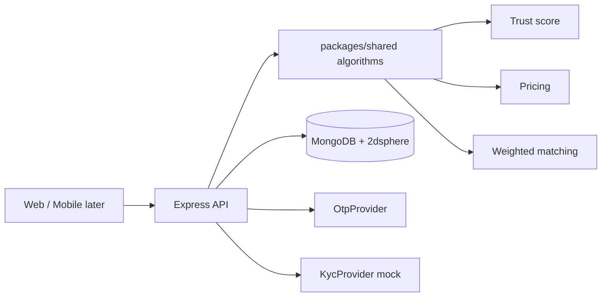

# KaamSetu

Hyperlocal digital labour marketplace for India's daily wage workers.

**Tagline:** Connecting Workers. Creating Opportunities.  
**Closing:** From Labour Chowks to Smart Hiring.

This repository currently includes **Stages 1–3** of `PROJECT_SPEC.md` (monorepo + API models/auth/seed + worker geo search, matching, pricing, trust score). Web UI, realtime booking, payments, and mobile are later stages.

## How to run (Stages 1–3)

Prerequisites: Node.js 20+, local MongoDB already running.

```bash
cd E:\dev\KaamSetu
npm install
npm run build -w @kaamsetu/shared
npm run seed
npm run dev:api
```

- API: [http://localhost:4000](http://localhost:4000)
- Health: [http://localhost:4000/health](http://localhost:4000/health)
- MongoDB: `mongodb://127.0.0.1:27017/kaamsetu` via `MONGODB_URI` in `.env`

### Tests (use mongodb-memory-server, not your local DB)

```bash
npm test
```

### Optional: Docker (API + web + Mongo)

```bash
docker compose up --build
```

Local development does **not** need Docker; use the MongoDB instance that is already running.

## Demo credentials (after seed)

OTP is always **123456** in development (`OTP_PROVIDER=dev`).

| Role     | Phone         |
|----------|---------------|
| Admin    | +919999999999 |
| Customer | +919000000001 (through +919000000015) |
| Worker   | +919100000001 (through +919100000060) |

Example:

```bash
curl -X POST http://localhost:4000/auth/otp/request -H "Content-Type: application/json" -d "{\"phone\":\"9000000001\"}"
curl -X POST http://localhost:4000/auth/otp/verify -H "Content-Type: application/json" -d "{\"phone\":\"9000000001\",\"otp\":\"123456\"}"
```

Search plumbers near Meerut:

```bash
curl "http://localhost:4000/workers/search?trade=plumber&lng=77.7064&lat=28.9845&radiusKm=10"
```

## Architecture



## Environment

See `.env.example`. Important variables:

- `MONGODB_URI` — default `mongodb://127.0.0.1:27017/kaamsetu`
- `OTP_PROVIDER` — `dev` | `msg91` | `firebase` (dev logs OTP 123456)
- `JWT_ACCESS_SECRET` / `JWT_REFRESH_SECRET`
- `PLATFORM_FEE_RATE` — default `0.08`
- `NEXT_PUBLIC_GOOGLE_MAPS_KEY` — unused until Stage 5 maps
- `OPENAI_API_KEY` — optional; `/ai/interpret` falls back to keywords

## Stage 3 API surface

| Method | Path | Notes |
|--------|------|--------|
| GET | `/health` | Liveness |
| POST | `/auth/otp/request` | `{ phone }` |
| POST | `/auth/otp/verify` | `{ phone, otp }` |
| POST | `/auth/refresh` | refresh rotation |
| POST | `/auth/logout` | |
| GET | `/auth/me` | Bearer token |
| POST | `/auth/role` | `{ role: customer\|worker, name? }` |
| GET | `/trades` | Catalogue |
| GET | `/workers/search` | Geo + match score |
| GET/PUT | `/workers/me` | Worker profile |
| PUT | `/workers/me/availability` | Available now |
| POST | `/workers/me/verification` | Mock KYC upload |
| GET | `/workers/:id` | Public profile |
| GET | `/workers/:id/trust` | Explainable breakdown |
| GET/PUT | `/customers/me` | Customer profile |
| POST | `/pricing/estimate` | Transparent fee breakdown |
| POST | `/ai/interpret` | Keyword trade mapper |
| GET | `/admin/verifications` | Admin queue |
| POST | `/admin/verifications/:id` | Approve / reject |

## Assumptions (Stages 1–3)

1. Demo city is Meerut, UP (`CITY_CONFIG` in `packages/shared`). Coordinates are GeoJSON `[lng, lat]`.
2. Development OTP is always `123456` and printed to the API console. Production-like SMS is behind `OtpProvider` only.
3. New workers with no jobs/reviews get **neutral 50** component scores so they are not buried at 0.
4. Night urgency stacks with emergency/same-day, **capped at 1.6**. Emergency intensity 0→1 maps multiplier 1.25→1.5.
5. Price min/max is ±10% around the point estimate (duration/site uncertainty).
6. ID numbers are stored **masked** (`XXXX-XXXX-last4`) only. KYC is `MockKycProvider`; admin manual review is the real gate.
7. Payments, Socket.io job flow, chat, ads serving, referrals UI, and Swagger are **Stage 4**. Interfaces for payment/notification exist so they can be wired later.
8. Web (`apps/web`) is a Next.js placeholder until Stage 5. Mobile is a package stub until Stage 8.
9. Seed **wipes** KaamSetu collections and recreates 1 admin, 15 customers, 60 workers, 150 bookings, reviews, ads, and plans.
10. Matching is an honest **weighted score** labelled as smart match, not a trained ML model. Free-text → trade uses keywords unless an LLM key is added later.
11. npm workspaces (not pnpm/turbo) so install works with stock Node on Windows.
12. Tests never touch `127.0.0.1:27017`; they boot `mongodb-memory-server`.

## Scripts

| Script | What it does |
|--------|----------------|
| `npm run dev:api` | API with tsx watch |
| `npm run seed` | Reset + seed local MongoDB |
| `npm test` | Shared unit tests + API integration tests |
| `npm run lint` | ESLint |
| `npm run build:api` | Compile shared + API |
